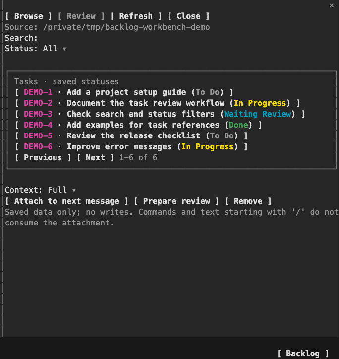
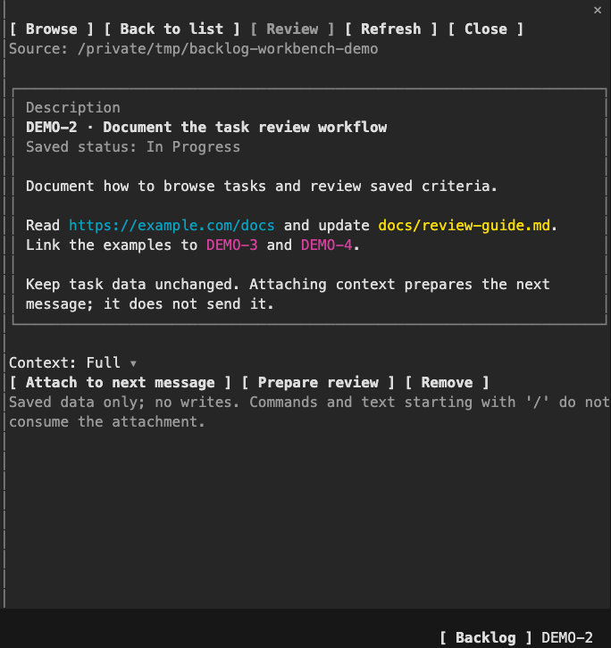

# Backlog Workbench

Browse [Backlog.md](https://github.com/MrLesk/Backlog.md) tasks inside Claude Code. A **Backlog** button in the prompt footer opens a pane with a searchable task list, a detail view, and saved acceptance criteria and Definition of Done checklists.

This is an experimental native mod. It reads task files and can attach selected task data to your next message. It does not edit tasks, mark work complete, or start agents.

## Screenshots

Rendered from native terminal captures with synthetic demo tasks. The images are cropped to the pane and the Backlog footer control.

### Browse tasks



### Read a task



## Requirements

- A macOS host. The reader uses `sandbox-exec` and macOS `O_NOFOLLOW_ANY`. It refuses to run on Linux or Windows.
- Node at `/opt/homebrew/bin/node`. This path currently targets an Apple Silicon Homebrew installation. Node 26.12.0 is the tested version.
- A Claude Code build with [native mods](https://code.claude.com/docs/en/plugins/mods/create), including `ui.render`, `SessionMode`, and the mod test kit. The mod was developed against the declarations generated by build 2.1.302. Older classic-hook-only plugin builds cannot run it.
- A project with `backlog/config.yml` directly under the directory where you start Claude Code. Custom Backlog directory layouts are not supported.

A Linux machine can act as an SSH terminal client while Claude Code and the reader run on the Mac. A separate desktop or Remote Control viewer is not covered by the terminal checks.

## Try it without a permanent installation

Clone this repository on your Mac:

```bash
git clone https://github.com/paoloantinori/backlog-workbench.git
cd backlog-workbench
PLUGIN_DIR="$PWD/plugin"
```

Change to the project that contains your backlog, then start Claude Code with the plugin:

```bash
cd /path/to/your/project
CLAUDE_CODE_NO_FLICKER=1 claude --plugin-dir "$PLUGIN_DIR"
```

Replace `/path/to/your/project` with your project directory. Use an absolute plugin path when you start Claude Code from another shell. The environment variable selects fullscreen rendering for this process so the terminal can report mouse clicks. This command does not change your settings or install a marketplace plugin.

To resume a conversation, add `--resume` to the same command. Keep `--plugin-dir` on resumed launches.

Click **Backlog** in the footer, then **Browse**. Click a task to replace the list with its detail. **Back to list** restores the search, status filter, and page. **Review** shows the saved criteria and DoD. **Refresh** rereads the files. You can also open or close the pane with `/backlog`.

The footer keeps the engine's existing content. When the terminal is narrow, the Backlog control can move to a separate footer row.

## Attach task data to a message

Select a task and choose **Brief**, **Criteria**, or **Full** from **Context**. Click **Attach to next message** to prepare the attachment, or **Prepare review** to include a request for an evidence-based review. Neither button sends a message or starts tests.

The next ordinary message receives the prepared context once. The mod rereads the task before delivery. If the task changed or validation failed, the mod stops that message and displays the reason. Review the detail and prepare again, or click **Remove** to send without the attachment.

Slash commands and text that starts with `/` do not consume the attachment. A session or project change invalidates it. The mod does not rearm a failed or interrupted delivery automatically.

Saved status and checklist markers are task data, not proof that a test passed or that work is complete. Task content is passed as untrusted data. When you attach it, the content goes to the model provider configured for that Claude Code session.

## Display and reader limits

- The UI is in English. Task titles, custom statuses, descriptions, and checklist text keep their original language.
- Task IDs are magenta. Saved statuses have distinct colors, with neutral styling for unknown values.
- In descriptions and checklists, HTTP and HTTPS links are cyan, file-like names and POSIX paths are yellow, and task IDs are magenta. This is lexical highlighting, not a check that a target exists. It adds no click actions.
- Descriptions display up to 2,400 characters and checklists up to 6,000, followed by a truncation marker. Highlighting stops after 128 colored segments; the remaining displayed text is preserved. Non-ASCII tokens remain uncolored.
- The list includes active tasks. IDs that collide across active, archived, or completed task files are reported separately. Unambiguous tasks remain browsable; an ambiguous task cannot be attached.
- The reader accepts files up to 1 MiB and a task corpus up to 16 MiB. A malformed task or a failed read produces an error rather than partial task data.
- The reader reuses parsing and ordering code from Backlog.md v1.54.0. It does not run the Backlog CLI, migrations, or an additional MCP server.

The reader subprocess has filesystem writes and network access denied. That policy is not a read-access sandbox for the entire Claude session. Other tools and plugins retain their own permissions. See [SECURITY.md](SECURITY.md) for the trust boundary.

## Build and test

The repository includes `plugin/reader.cjs`, so using the mod does not require npm dependencies. To rebuild it, use Bun 1.3.14 and the committed npm lockfile:

```bash
cd reader
npm ci --ignore-scripts --no-audit --no-fund
npm run build
npm test
cd ..
claude plugin test ./plugin
claude plugin validate ./plugin --strict
```

Reader tests use temporary synthetic projects. Plugin tests run through the Claude Code mod test kit, not a standalone JavaScript test runner.

When you load the mod interactively with `--plugin-dir`, Claude Code generates `.claude-plugin/types/` for its own build. Those declarations are ignored by Git. After that first load, if TypeScript is available, check the mod with:

```bash
tsc -p ./plugin
```

Do not copy generated declarations from another Claude Code version into the repository. The runtime's declarations describe the API actually available on that build.

## License and attribution

The original code is MIT licensed. Backlog.md source provenance is recorded in `reader/vendor/provenance.json`, with its original license in `reader/vendor/LICENSE`.

The distributable `plugin/` directory includes `LICENSE` and `THIRD_PARTY_NOTICES.md`. Keep both files with the bundled reader when you redistribute the mod. The reader build regenerates the third-party notices from its pinned dependencies.
